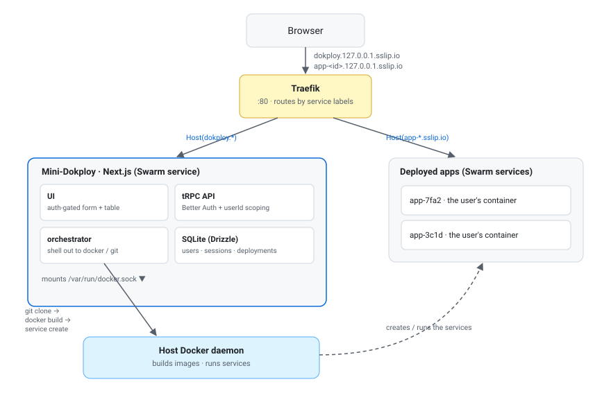

# Mini-Dokploy

A tiny self-hosted PaaS. Give it a Git repo, a Dockerfile path and a port; it builds the image,
runs it as a Docker Swarm service, and exposes it through Traefik on a generated
`*.127.0.0.1.sslip.io` subdomain. A small UI lists deployments and lets you redeploy or remove them.

Everything runs locally — no VPS, no cloud. Mini-Dokploy itself also runs as a Docker service.

## Stack

TypeScript · Next.js (Pages Router) · tRPC · Drizzle + SQLite · Docker Swarm · Traefik

## Setup

Prerequisites: Docker (Swarm mode) and pnpm.

```bash
make up
```

One command: inits Swarm, creates the overlay network, builds the image, and deploys the stack
(Traefik + Mini-Dokploy). Then:

- App — <http://dokploy.127.0.0.1.sslip.io>
- Traefik dashboard — <http://localhost:8080>
- Tear down — `make down`

For development against the source:

```bash
pnpm install
pnpm db:migrate          # create the SQLite DB from the schema
pnpm dev                 # http://localhost:3000
pnpm test                # unit tests (pure command/label construction)

make swarm-init network-create stack-deploy   # Traefik, so deploys are routable
```

## Architecture

One Next.js process serves both the UI and the tRPC API; state lives in SQLite via Drizzle.



- **`orchestrator.ts`** is the core. It shells out to `docker`/`git` via `child_process`. The
  command construction (Traefik labels, `docker service create` args) is pure and unit-tested; the
  execution is a thin side-effect that isn't.
- **Traefik** runs as a Swarm service with the swarm provider. Each deployed service carries
  `traefik.*` labels that Traefik reads to route its subdomain — no Traefik config to touch per app.
- **Lifecycle**: a row is inserted as `DEPLOYING`, then updated to `DEPLOYED` or `FAILED`.
- **Mini-Dokploy as a service**: its image bundles `docker-cli` + `git`, and the host Docker socket
  is mounted in so it can drive the daemon. `docker build` ships the build context to the daemon, so
  the clone can live in the container's own `/tmp` — no shared host path needed.

## Decisions and what I'd build next

Deliberate, time-boxed scope cuts:

- **No repository pattern.** tRPC talks to Drizzle directly. In a longer-lived codebase I'd invert
  it — a `DeploymentRepository` port + a Drizzle adapter injected through the tRPC context — so
  swapping the ORM touches a couple of files instead of every router.
- **Custom labels are metadata-only.** The platform owns routing; user-supplied `traefik.*` labels
  are rejected, since in a multi-tenant PaaS letting a user inject routing labels is a hijack vector.
- **Subdomains come from a user-chosen name**, sanitized into a slug — memorable URLs over an opaque
  ID. Two users picking the same name would collide; a real version would append a short unique
  suffix (`app-mystore-7fa2`) or scope uniqueness per user.
- **Everything is exposed by default.** A deployment always gets Traefik labels + a subdomain.
  Databases, workers and other internal services are out of scope; a real version would make exposure
  a toggle — unexposed services get no Traefik labels and stay reachable only by service name.
- **redeploy = remove + create**, to reuse the tested create path. Cost: a failed redeploy leaves
  the app down. A real version would use `docker service update --image --force` (rolling).
- **Optimistic status, no polling.** Deploy is synchronous, so `DEPLOYED` is set when
  `docker service create` returns. The real state would come from polling `docker service ps`.
- **Orchestrator — known cuts.** `FAILED` rows don't store the error/build logs (no column for it);
  the clone temp dir is fixed and never cleaned (concurrent deploys of the same repo collide, and
  `/tmp` leaks); a process killed mid-deploy leaves a row stuck in `DEPLOYING` (a real version
  reconciles or times out); and `deploy`/`redeploy` duplicate the clone→build→status flow, which
  I'd extract into a `cloneAndBuild` + `withStatus` helper.
- **`:latest` image tag** — fine locally. Versioned tags (commit hash) would enable rollback, and
  then the tag would be worth persisting (it's derivable today, so it isn't).
- **Multi-tenancy is data-level only** (a per-user `userId` filter). Runtime isolation between
  tenants — per-tenant networks, resource quotas — is out of scope.
- **Security**: building and running arbitrary repos is unsafe; a real PaaS sandboxes builds, limits
  resources, and scans images. The mounted socket is root-equivalent on the host.
- **Images are built for the host's architecture** (no `--platform`); build and run are co-located, so
  the arch always matches. For heterogeneous nodes a real version would use `docker buildx`
  multi-platform builds pushed to a registry, so each node pulls its own variant.
- **Single node + SQLite.** Multi-node would need a registry so nodes can pull built images.
- **Tested the pure logic, not the plumbing.** Unit tests cover the deterministic command/label
  construction (Traefik labels, subdomain, `docker build`/`service create` args); the Docker execution
  and trivial pass-throughs aren't tested — mocking the CLI would be over-testing for the value.
- **No live build logs (WebSocket).** Deploy is synchronous and returns when it finishes, so there's
  nothing to stream. Streaming `docker build` output live would mean an async deploy (return
  immediately, build in the background) + a job runner + a WebSocket transport (tRPC subscriptions) —
  the same async/streaming shift as the optimistic status, so both are left out to keep the model simple.

## How I used AI tools (and where I didn't)

AI: the documentation, the project scaffold, the tests, the React UI, the Docker/Swarm packaging (Dockerfile, stack,
Makefile)

I did the orchestration core (clone → build → service create + the status
lifecycle «as a state machine»), the Traefik label generation and name sanitization,
the tRPC routers, the Drizzle schema, command-execution error handling, and the
authentication / authorization layer — Better Auth wiring plus the data-level
multi-tenancy (per-user `userId` scoping on every query).
